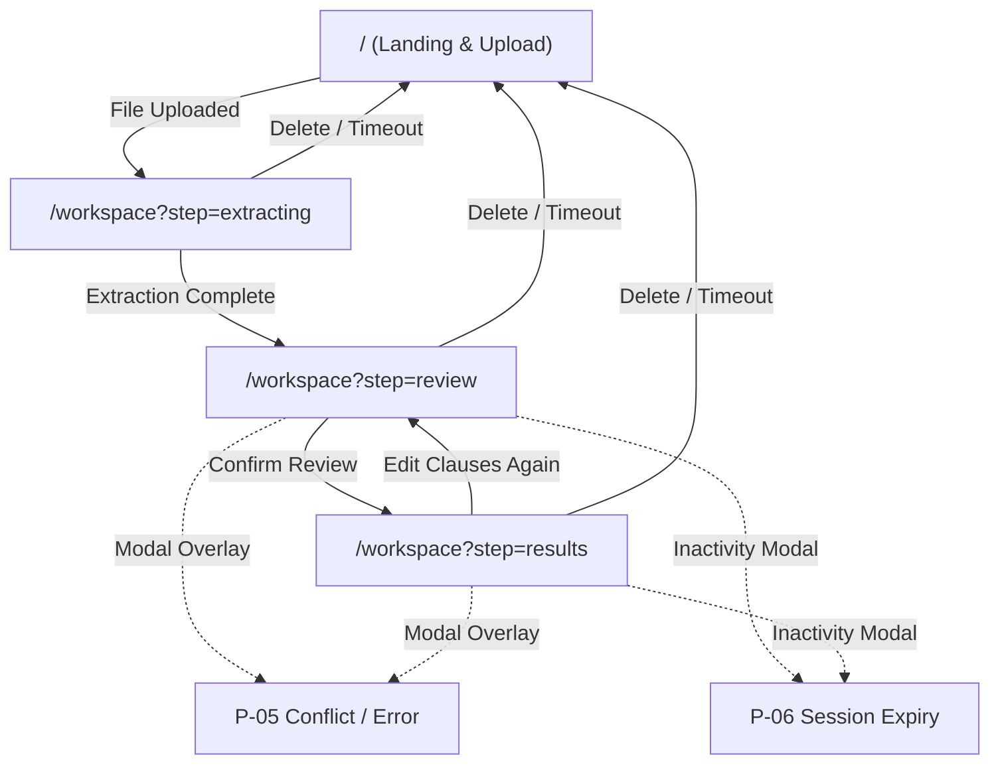
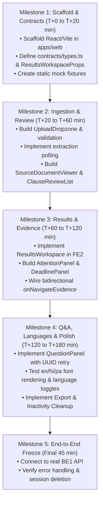

# Frontend Requirements Specification: NyayaLens

**Project Name:** NyayaLens (Plain Language Legal Document & FIR Explainer)  
**Prepared:** 2026-10-30  
**Version:** 1.0.0-PROD-SPEC  
**Input Status:** **REPORT ONLY** (Backend code not yet implemented; requirements derived from frozen Contract v1 and architecture handoffs)  
**Source File List:**
- `01-FRONTEND-1-App-Upload-Source.md` (`[R: 01-FE1]`)
- `02-FRONTEND-2-Results-Evidence-Chat.md` (`[R: 02-FE2]`)
- `03-BACKEND-1-API-Extraction-Sessions.md` (`[R: 03-BE1]`)
- `04-BACKEND-2-Local-ML-Training-Languages.md` (`[R: 04-BE2]`)

**Label Legend:**
- **SOURCE-STATED**: Explicitly stated in a report/handoff specification with section reference.
- **BACKEND-VERIFIED**: Read in actual backend code or verified API schema file (N/A for unbuilt backend).
- **PLANNED**: Described in specification but backend implementation is pending.
- **INFERRED**: Derived logically from stated requirements; foundation stated.
- **MISSING**: Required by frontend but undefined in sources; listed in Gaps (Section 22).
- **CONFLICT**: Disagreement between specifications; documented with resolution.

**Priority Levels:**
- **MVP**: Essential for initial demonstration and core flow.
- **P1**: Primary feature required for complete end-to-end evaluation.
- **P2**: Secondary enhancement or resilience feature.
- **LATER**: Post-hackathon or out-of-scope backlog.

**Scope Notice:** Frontend requirements only. Design requirements (colors, typography, spacing, layout aesthetics, theming, iconography, branding, animation style, mockups, look and feel) are intentionally excluded.

---

## 0. Summary

NyayaLens is a client-facing web application that ingests legal contracts, police First Information Reports (FIRs), and legal notices, parses their text locally, allows human verification of extracted clauses, and presents clause-by-clause plain-language explanations in English, Hindi (Devanagari), or Punjabi (Gurmukhi). It identifies potential concern cues (attention items), tracks deadlines and relative timelines, provides grounded conversational question answering with direct citations to original document text, and links users to official statutory references and NALSA legal aid services.

The frontend is responsible for the complete user experience: file selection, pre-upload validation, document structure visualization (PDF rendering / DOCX paragraph inspection), extraction progress polling, optimistic clause correction and revision synchronization, analysis job lifecycle management, tabbed results presentation, bidirectional evidence navigation (clicking an explanation focuses the original text in the source viewer), interactive Q&A, session lifecycle and temporary privacy wiping, and client-side report export.

**Specification Metric Counts:**
- Total Features: 16 (`F-01` to `F-16`)
- Total Pages/Screens/Distinct Views: 6 (`P-01` to `P-06`)
- Total API Endpoints Defined & Mapped: 10 (`E-01` to `E-10`)
- Total Functional Components: 14 (`C-01` to `C-14`)
- Total User Flows: 5 (`UF-01` to `UF-05`)
- Total Gaps / Open Decisions Identified: 7 (`GAP-01` to `GAP-07`)
- Total Specification Conflicts Documented: 2 (`CONF-01` to `CONF-02`)

**Completeness Level:** 100% of stated report capabilities, contracts, data models, error codes, and edge cases are captured without fabricating unstated backend behavior.

---

## 1. Sources and Method

### 1.1 Source Documents
1. `01-FRONTEND-1-App-Upload-Source.md` (`[R: 01-FE1]`): Handoff specification for Frontend Role 1 (App shell, upload, extraction review, source viewer, shared contract/client, state management).
2. `02-FRONTEND-2-Results-Evidence-Chat.md` (`[R: 02-FE2]`): Handoff specification for Frontend Role 2 (Results workspace, attention cards, timelines, questions, export, evidence navigation).
3. `03-BACKEND-1-API-Extraction-Sessions.md` (`[R: 03-BE1]`): Specification for Backend Role 1 (Public API, extraction/OCR pipeline, session lifecycle, document revisions, job queue, cleanup).
4. `04-BACKEND-2-Local-ML-Training-Languages.md` (`[R: 04-BE2]`): Specification for Backend Role 2 (GPU ML service, datasets, classification, Qwen 4B local LLM inference, translation-assisted pipeline, evidence validation).

### 1.2 Backend Status & Method
The project repository currently contains no executable backend code (`apps/api` or `apps/ml` have not been scaffolded). However, all four documents contain an identical, frozen "Contract v1" specification defining route paths, HTTP methods, multipart parameters, JSON request/response schemas, HTTP status codes, error models, and session tokens. All backend-dependent capabilities are marked **PLANNED**.

### 1.3 Key Architectural Assumptions
- **Single-Page Application (SPA):** The frontend runs as a client-side SPA (React + TypeScript + Vite) connecting to the backend via a reverse proxy (`/api/v1`). `[R: 01-FE1 §Repository layout to create together]`
- **Stateless Authentication / Opaque Session Tokens:** No user login or registration system exists. Every uploaded document creates an isolated, anonymous session identified by an ephemeral `session_token` transmitted via the `X-Session-Token` HTTP header. `[R: 01-FE1 §Data/state implementation details]`
- **Local Ephemeral Storage:** Session tokens and document contents must exist only in volatile browser memory. LocalStorage, IndexedDB, cookies, and session replay analytics are strictly prohibited. `[R: 01-FE1 §Data/state implementation details]`

---

## 2. Users, Roles, and Goals

| Role / Persona | Description | Needs & Goals | Permissions Summary | Source Ref | Label |
|---|---|---|---|---|---|
| **Citizen / Consumer (Anonymous)** | A citizen, tenant, employee, or litigant reviewing an agreement, FIR, or legal notice. Non-expert in law. | - Upload agreement/FIR/notice.<br>- Verify OCR accuracy.<br>- Read plain-language summary in preferred language (`en`/`hi`/`pa`).<br>- Spot deadlines and red-flag clauses.<br>- Ask clarifying questions.<br>- Export a copy and wipe server data. | Full control over the specific document session created in their browser tab. Cannot access other sessions. | `[R: 01-FE1 §Shared project brief]` | SOURCE-STATED |
| **Legal Aid Provider / Paralegal** | Community legal worker assisting citizens with document intake. | - Validate extraction against physical original.<br>- Review clause classifications.<br>- Export structured Markdown/print reports for case intake. | Identical to Citizen; operates on per-document ephemeral session token. | `[R: 01-FE1 §Shared project brief]` | INFERRED (based on legal aid scope) |

*Note: Administrative, reviewer, or multi-tenant user roles are explicitly excluded from the product scope. `[R: 01-FE1 §Data/state implementation details]`*

---

## 3. Scope and Priorities

### 3.1 In-Scope (Functional)
- PDF and DOCX file ingestion with client-side format and size pre-checks. `[R: 01-FE1 §User journey you implement]`
- Multilingual selection: Input language (`auto`, `en`, `hi`, `pa`) and Target Output Language (`en`, `hi`, `pa`) configured independently. `[R: 01-FE1 §Product scope and multilingual truth]`
- Document classification selector: `auto`, `agreement`, `fir`, `notice`, `other`. `[R: 01-FE1 §User journey you implement]`
- Split-screen workspace: synchronized document source viewer (left) alongside extraction review / results (right). `[R: 01-FE1 §User journey you implement]`
- In-memory human-in-the-loop clause editing with optimistic revision conflict management (HTTP 409 handling). `[R: 01-FE1 §Data/state implementation details]`
- Asynchronous polling of backend extraction and ML analysis jobs (no websockets/streaming). `[R: 01-FE1 §Shared development and integration rules]`
- Clause-by-clause plain-language explanations with completeness coverage counters. `[R: 02-FE2 §UX and behavior]`
- Potential concern category cards with exact quoted source text. `[R: 02-FE2 §UX and behavior]`
- Deadline tracking panel highlighting absolute dates, relative periods, and missing anchor information. `[R: 02-FE2 §UX and behavior]`
- Grounded conversational Q&A panel scoped strictly to the current document with citation jumping. `[R: 02-FE2 §Questions and evidence]`
- Bi-directional evidence jumping: clicking an evidence citation focuses the exact page/paragraph in the source viewer. `[R: 02-FE2 §UX and behavior]`
- Explicit session termination: instant client memory wipe, object URL revocation, and server-side deletion (`DELETE /documents/{id}`). `[R: 01-FE1 §Data/state implementation details]`
- Client-side report generation (Markdown download and browser Print). `[R: 02-FE2 §Export and privacy]`

### 3.2 Out-of-Scope (Explicitly Prohibited)
- User authentication, user accounts, persistent user profiles, passwords, or cloud database storage. `[R: 01-FE1 §Data/state implementation details]`
- Legal enforceability or danger scoring (no "95% Safe" meters or risk scores). `[R: 02-FE2 §UX and behavior]`
- Enforceable deadline calculation (no dynamic computation of court limitation periods). `[R: 02-FE2 §UX and behavior]`
- External commercial AI API calls (no OpenAI, Anthropic, or external translation services from the browser). `[R: 01-FE1 §Shared project brief]`
- Autonomous agents, graph databases, or cloud vector stores. `[R: 01-FE1 §Frozen architecture]`
- Audio speech-to-text, handwriting recognition, Romanized Punjabi, or Shahmukhi script. `[R: 01-FE1 §Product scope and multilingual truth]`

### 3.3 Scope Tiers & Priority Classification

| Priority Tier | Criteria & Stated Milestone | Features Included |
|---|---|---|
| **MVP** | Core end-to-end pipeline required for T+60 checkpoint. | `F-01`, `F-02`, `F-03`, `F-04`, `F-05`, `F-07`, `F-08`, `F-12`, `F-13` |
| **P1** | Essential hackathon demo features (T+120 to T+180 checkpoint). | `F-06`, `F-09`, `F-10`, `F-11`, `F-14`, `F-15` |
| **P2** | Extended resilience, multilingual edge cases, and accessibility. | `F-16` |
| **LATER** | Post-evaluation enhancements. | Batch document processing, multi-party clause comparison. |

---

## 4. Feature Inventory

| Feature ID | Feature Name | Description | Target Role | Priority | Backend Support | Acceptance Criteria | Source Ref | Label |
|---|---|---|---|---|---|---|---|---|
| **F-01** | Landing & Health Telemetry | Displays product scope, offline processing disclosure, backend service health, and language support matrix. | Citizen | MVP | PLANNED | Renders system status from `/health`; displays available OCR languages and tested language matrix; shows clear privacy notice. | `[R: 01-FE1 §User journey, 01-FE1 §Contract v1]` | SOURCE-STATED |
| **F-02** | Document Ingestion & Validation | Accepts PDF/DOCX via file picker/drag-drop; enforces 10MB/20-page limits; configures input language and document type. | Citizen | MVP | PLANNED | Rejects 0-byte, oversize, or invalid MIME files client-side; sends multipart form; receives `document_id` and `session_token`. | `[R: 01-FE1 §User journey, 03-BE1 §Extraction implementation]` | SOURCE-STATED |
| **F-03** | Extraction Polling Engine | Polls document extraction state without fake progress timers until extraction is ready or failed. | Citizen | MVP | PLANNED | Polls `GET /documents/{id}` every 1–2s; transitions UI upon `awaiting_review`; exposes extraction errors with retry actions. | `[R: 01-FE1 §User journey, 01-FE1 §Shared development rules]` | SOURCE-STATED |
| **F-04** | Synchronized Source Viewer | Renders original PDF pages (via PDF.js) or DOCX paragraphs; exposes coordinate bounding box or page/paragraph navigation. | Citizen | MVP | PLANNED | Fetches binary file via authenticated Blob URL; renders canvas; supports scrolling to target `page_number` or `paragraph_index`. | `[R: 01-FE1 §Data/state implementation details]` | SOURCE-STATED |
| **F-05** | Human Clause Verification & Editing | Lists extracted clauses; highlights OCR confidence warnings; allows inline human correction of clause text. | Citizen | MVP | PLANNED | Users can edit `reviewed_text`; submittal sends `PATCH /extraction` with `expected_revision`; invalidates downstream results. | `[R: 01-FE1 §User journey, 01-FE1 §Contract v1]` | SOURCE-STATED |
| **F-06** | Optimistic Revision Conflict Handling | Resolves race conditions and stale clause edits when server revision increments. | Citizen | P1 | PLANNED | On HTTP 409, prompts user with conflict dialog, reloads current server extraction, and prevents data overwrite. | `[R: 01-FE1 §User journey, 01-FE1 §Contract v1]` | SOURCE-STATED |
| **F-07** | Analysis Job Orchestration | Triggers and monitors asynchronous AI analysis jobs for a reviewed revision in the chosen output language. | Citizen | MVP | PLANNED | Submits `POST /analyses`; polls status every 1–2s; renders actual `completed_clauses`/`total_clauses`; stops on completion or unmount. | `[R: 02-FE2 §Analysis and translation lifecycle]` | SOURCE-STATED |
| **F-08** | Clause-by-Clause Plain Explanations | Displays plain-language explanation for every clause; never silently drops ordinary clauses; displays coverage counters. | Citizen | MVP | PLANNED | Renders `items`; shows analyzed/total coverage; shows original quote and translated explanation; supports Devanagari/Gurmukhi scripts. | `[R: 02-FE2 §UX and behavior]` | SOURCE-STATED |
| **F-09** | Potential Concern (Attention) Cards | Flags risky clauses (arbitration, auto-renewal, unilateral termination, liability caps) with exact quote and limitations. | Citizen | P1 | PLANNED | Renders attention category; quotes exact substring of reviewed text; displays rule/model provenance; no danger meters. | `[R: 02-FE2 §UX and behavior]` | SOURCE-STATED |
| **F-10** | Deadline & Timeline Tracker | Extracts explicit calendar dates and relative timeframes; highlights missing reference information. | Citizen | P1 | PLANNED | Separates explicit dates from relative periods (e.g. "within 15 days of receipt"); flags missing anchor date; no synthetic calculations. | `[R: 02-FE2 §UX and behavior]` | SOURCE-STATED |
| **F-11** | Grounded Q&A Assistant | Document-scoped interactive question answering backed strictly by document text and official references. | Citizen | P1 | PLANNED | Sends `POST /questions` with UUID `client_request_id`; handles 429 busy with retry; refuses out-of-scope questions; cites source clause. | `[R: 02-FE2 §Questions and evidence]` | SOURCE-STATED |
| **F-12** | Bidirectional Evidence Navigation | Links explanation/attention/Q&A evidence directly to source document viewer. | Citizen | MVP | PLANNED | Clicking "View Evidence" invokes `onNavigateEvidence(clauseId)`, highlighting and scrolling source viewer to the exact clause. | `[R: 01-FE1 §Deliverables, 02-FE2 §UX and behavior]` | SOURCE-STATED |
| **F-13** | Session Privacy & Memory Wipe | Wipes all session data from client memory and triggers server deletion of temporary files. | Citizen | MVP | PLANNED | `DELETE /documents/{id}` called; revokes all Blob URLs; resets in-memory React state; navigates back to landing screen. | `[R: 01-FE1 §Data/state implementation details]` | SOURCE-STATED |
| **F-14** | Inactivity Expiration Watchdog | Tracks session inactivity and alerts user before automatic server expiration. | Citizen | P1 | PLANNED | Displays countdown timer based on 30-minute retention policy; warns user 2 minutes prior; wipes client state upon expiration. | `[R: 01-FE1 §Safety and source rules, 03-BE1 §Session and privacy]` | SOURCE-STATED |
| **F-15** | Report Export (Markdown & Print) | Generates clean, client-side downloadable Markdown summary and print-optimized view. | Citizen | P1 | PLANNED | Generates `.md` file containing metadata, explanations, attention points, and deadlines; strictly excludes session tokens. | `[R: 02-FE2 §Export and privacy]` | SOURCE-STATED |
| **F-16** | Legal Aid Directory Linking | Displays verified links to official legal aid resources (NALSA) with clear external-navigation disclaimers. | Citizen | P2 | PLANNED | Renders official NALSA cards; clicking opens official URL in new tab with explicit outbound indicator. | `[R: 02-FE2 §Questions and evidence]` | SOURCE-STATED |

---

## 5. Pages and Screens Inventory

| Page ID | Name | Route Path | Access Rule | Features Covered | Data Shown | User Actions | API / Event Calls | States | Navigates From / To | Source Ref | Label |
|---|---|---|---|---|---|---|---|---|---|---|---|
| **P-01** | Landing & Upload Screen | `/` | Public (Anonymous) | `F-01`, `F-02` | - Service status & model readiness.<br>- Supported language matrix.<br>- Privacy notice.<br>- Upload file picker & limits. | - Select file.<br>- Select input language.<br>- Select target answer language.<br>- Select document type.<br>- Click "Extract Document". | `GET /health`<br>`POST /documents` | Initial, Health Loading, Health Error, File Dragged, Validating, Uploading, Upload Error. | From: Initial load, Session Termination.<br>To: `P-02` | `[R: 01-FE1 §User journey]` | SOURCE-STATED |
| **P-02** | Extraction Processing Screen | `/workspace?step=extracting` | Session Active (`document_id` + `session_token`) | `F-03`, `F-13` | - Current extraction status message.<br>- Document filename & size.<br>- Polling indicator. | - Cancel extraction / Wipe session. | `GET /documents/{id}`<br>`DELETE /documents/{id}` | Extracting (Polling), Low OCR Quality Warning, OCR Failed, Timeout, Cancelled. | From: `P-01`<br>To: `P-03`, `P-01` (on cancel) | `[R: 01-FE1 §User journey]` | SOURCE-STATED |
| **P-03** | Split Workspace: Clause Review | `/workspace?step=review` | Session Active (`status == awaiting_review`) | `F-04`, `F-05`, `F-06`, `F-12`, `F-13` | - Left: Original PDF canvas / DOCX paragraphs.<br>- Right: Clause list, `source_text`, `reviewed_text`, OCR warnings.<br>- Revision indicator. | - Scroll source document.<br>- Edit clause text inline.<br>- Click clause to navigate source.<br>- Click "Confirm Review & Analyse".<br>- Click "Delete Session". | `GET /documents/{id}/source`<br>`GET /documents/{id}/extraction`<br>`PATCH /documents/{id}/extraction`<br>`DELETE /documents/{id}` | Loading Source, Loading Extraction, Ready, Editing Clause, Submitting Revision, Conflict (409), Error. | From: `P-02`<br>To: `P-04`, `P-01` | `[R: 01-FE1 §User journey, 01-FE1 §Data/state]` | SOURCE-STATED |
| **P-04** | Split Workspace: Analysis & Results | `/workspace?step=results` | Session Active (`status >= queued`) | `F-04`, `F-07`, `F-08`, `F-09`, `F-10`, `F-11`, `F-12`, `F-15`, `F-16` | - Left: Source document viewer.<br>- Right Tabs: Overview, Clauses, Attention, Deadlines, Ask Q&A, Export.<br>- Real progress counter (`completed/total`). | - Switch tabs.<br>- Click "View Evidence" (navigates source).<br>- Switch output language.<br>- Submit Q&A question.<br>- Download Markdown / Print.<br>- Click "Delete Session". | `POST /documents/{id}/analyses`<br>`GET /documents/{id}/analyses/{analysis_id}`<br>`POST /documents/{id}/questions`<br>`DELETE /documents/{id}` | Analysis Queued, Running (Progress), Complete, Partial / Needs Review, Analysis Failed, Q&A Busy, Q&A Error. | From: `P-03`<br>To: `P-03` (re-edit), `P-01` (wipe) | `[R: 02-FE2 §UX and behavior]` | SOURCE-STATED |
| **P-05** | Error & Conflict Overlay | Modal / In-Page Banner | Session Active | `F-06`, `F-11`, `F-14` | - Error title & actionable description.<br>- Conflict details (expected vs actual revision).<br>- Retry eligibility indicator. | - Dismiss modal.<br>- Reload current server revision.<br>- Retry request.<br>- Wipe session. | Handled locally via API error shapes (`code`, `retryable`). | Conflict (409), Model Busy (429), Session Expired (404), Connection Lost. | Triggered from `P-02`, `P-03`, `P-04`. | `[R: 01-FE1 §Data/state, 02-FE2 §Integration examples]` | SOURCE-STATED |
| **P-06** | Session Inactivity Warning Modal | Modal Dialog | Session Active | `F-13`, `F-14` | - Countdown timer (e.g. "Session expires in 120s due to inactivity").<br>- Data privacy warning. | - Click "Extend Session" (resets timer).<br>- Click "Wipe & Exit Now". | `GET /documents/{id}` (heartbeat extends TTL) or `DELETE /documents/{id}` | Warning Active, Expired / Wiped. | Triggered from `P-03`, `P-04`. | `[R: 01-FE1 §Safety and source rules, 03-BE1 §Session and privacy]` | SOURCE-STATED |

---

## 6. Sitemap, Routes, and Guards

### 6.1 Route Table



| Path | Query Params | Allowed Roles | Guard / Prerequisite Condition | Failure / Redirect Behavior | Source Ref | Label |
|---|---|---|---|---|---|---|
| `/` | None | All | None | None | `[R: 01-FE1 §User journey]` | SOURCE-STATED |
| `/workspace` | `step=extracting` | Anonymous Session | `documentId` and `sessionToken` must exist in React state. | Redirect to `/` with notice "No active session". | `[R: 01-FE1 §Data/state]` | INFERRED |
| `/workspace` | `step=review` | Anonymous Session | `documentId`, `sessionToken`, and extracted clauses loaded. | If no session, redirect to `/`. If still extracting, redirect to `step=extracting`. | `[R: 01-FE1 §Data/state]` | INFERRED |
| `/workspace` | `step=results` | Anonymous Session | `documentId`, `sessionToken`, and `revision >= 1` verified. | If review not confirmed, redirect to `step=review`. | `[R: 01-FE1 §Data/state]` | INFERRED |
| `/*` | Any | All | None | Renders 404 Not Found screen with "Return to Home" button. | `[R: 01-FE1 §Repository layout]` | INFERRED |

### 6.2 Route Protection & State Preservation Guard
- **No URL Leaks:** The `sessionToken` and `documentId` are strictly forbidden from appearing in URL search parameters or hash fragments to prevent leakage via browser history, bookmarks, or referrer headers. `[R: 01-FE1 §Data/state implementation details]`
- **Browser Reload Behavior:** Refreshing the browser flushes volatile React state. The router must detect an empty in-memory store on `/workspace`, display an explicit session expiration notice, and redirect to `/`. `[R: 01-FE1 §Data/state implementation details]`

---

## 7. User Flows

### UF-01: Document Upload and Extraction Review (Happy Path)
1. **P-01:** User selects a PDF/DOCX file (<10MB, <20 pages).
2. **P-01:** User selects input language (`auto`), target output language (`hi`), and document type (`agreement`).
3. **P-01:** User clicks "Extract Document". Frontend issues `POST /documents`.
4. **P-01 -> P-02:** Frontend receives HTTP 202 with `document_id`, `session_token`, `revision: 1`. State stored in memory. Transitions to `P-02`.
5. **P-02:** Frontend polls `GET /documents/{id}` every 1.5s.
6. **P-02 -> P-03:** Polling returns `status: awaiting_review`. Frontend fetches:
   - Original file: `GET /documents/{id}/source` as Blob URL.
   - Extracted text: `GET /documents/{id}/extraction`.
7. **P-03:** User inspects clauses in the right pane alongside the PDF canvas on the left.
8. **P-03:** User corrects an OCR error in Clause 2.
9. **P-03:** User clicks "Confirm Review & Analyse". Frontend issues `PATCH /documents/{id}/extraction` with `expected_revision: 1`.
10. **P-03:** Backend returns `revision: 2`. Frontend transitions to `P-04`. `[R: 01-FE1 §User journey]`

### UF-02: Revision Conflict During Editing (Error Branch)
1. **P-03:** User is editing clause text in browser tab with `revision: 1`.
2. **P-03:** User submits corrections (`PATCH /documents/{id}/extraction` with `expected_revision: 1`).
3. **P-03 -> P-05:** Backend returns `HTTP 409 REVISION_CONFLICT` because the server revision is already `2`.
4. **P-05:** Conflict modal appears: *"The document was updated in another request. Your changes cannot overwrite the newer revision."*
5. **P-05:** User clicks "Reload Latest". Frontend refetches `GET /documents/{id}/extraction`, updates state to `revision: 2`, and restores edit mode. `[R: 01-FE1 §Data/state implementation details]`

### UF-03: AI Analysis and Evidence Navigation (Happy Path)
1. **P-04:** Results workspace initializes. Frontend issues `POST /documents/{id}/analyses` with `expected_revision: 2` and `output_language: "hi"`.
2. **P-04:** Backend returns HTTP 202 with `analysis_id: "a1"`.
3. **P-04:** Frontend polls `GET /documents/{id}/analyses/a1` every 1.5s.
4. **P-04:** UI displays actual progress: `completed_clauses: 4 / total_clauses: 8`.
5. **P-04:** Polling returns `status: complete` with full payload (items, attention, deadlines, legal aid).
6. **P-04:** User switches to the "Attention" tab and clicks "View Evidence" on an *Automatic Renewal* card (`clause_id: "c3"`).
7. **P-04:** `onNavigateEvidence("c3")` fires.
8. **P-04 (Left Pane):** Source viewer scrolls to page 2, highlights bounding box `[x0, y0, x1, y1]` (or paragraph 3 if DOCX), and pulses selection. `[R: 02-FE2 §UX and behavior]`

### UF-04: Grounded Question Answering and Retry
1. **P-04:** User navigates to the "Ask / Q&A" tab.
2. **P-04:** User types: *"What is the notice period for early termination?"*
3. **P-04:** User clicks "Ask". Frontend generates UUID `client_request_id`, disables input, and sends `POST /documents/{id}/questions`.
4. **Branch A (Success):** Backend returns HTTP 200 with answer, evidence quote, and citation clause ID. Answer rendered with clickable evidence badge.
5. **Branch B (Model Busy - 429):** Backend returns `HTTP 429 MODEL_BUSY`. Frontend displays warning banner: *"AI model is currently busy. Click Retry to resubmit."* Input remains preserved; user clicks "Retry" which resubmits the identical `client_request_id` without creating duplicate jobs.
6. **Branch C (Out of Scope):** Backend returns `review_status: needs_review` with answer: *"The document does not specify an early termination notice period."* Frontend renders honest limitation badge. `[R: 02-FE2 §Questions and evidence]`

### UF-05: Explicit Session Cleanup & Privacy Wiping
1. **P-03 / P-04:** User clicks "Delete Session" in the top bar.
2. **P-06:** Confirmation dialog prompts: *"Are you sure? All uploaded files, extracted text, and AI summaries will be permanently deleted from this machine."*
3. **P-06:** User confirms.
4. **P-06:** Frontend immediately:
   - Aborts all active polling timers and fetch requests via `AbortController`.
   - Sends `DELETE /documents/{id}` to backend.
   - Revokes all temporary Blob URLs via `URL.revokeObjectURL()`.
   - Wipes all in-memory React state (tokens, clauses, results).
5. **P-06 -> P-01:** Navigates user to Landing Page (`/`) with toast: *"Session securely deleted."* `[R: 01-FE1 §Data/state, 02-FE2 §Export and privacy]`

---

## 8. Functional Component Inventory

| Component ID | Component Name | Functional Purpose | Inputs (Props) | Outputs / Events Triggered | API / Data Used | Used on Page(s) | Source Ref | Label |
|---|---|---|---|---|---|---|---|---|
| **C-01** | `AppShell` | Global application container, session state holder, header navigation, delete session trigger. | None (Root) | `onResetSession()` | In-memory session store | `P-01` to `P-06` | `[R: 01-FE1 §Deliverables]` | SOURCE-STATED |
| **C-02** | `HealthStatusBar` | Shows backend connectivity, OCR engine readiness, local LLM status, and tested language combinations. | `healthData: HealthResponse` | `onRetryHealth()` | `GET /health` | `P-01` | `[R: 01-FE1 §Deliverables, 01-FE1 §Contract v1]` | SOURCE-STATED |
| **C-03** | `UploadDropzone` | File input selection, drag-and-drop handler, client-side size/MIME validation. | `disabled: boolean` | `onFileSelected(file: File)` | Client-side File API | `P-01` | `[R: 01-FE1 §Deliverables]` | SOURCE-STATED |
| **C-04** | `LanguageDocTypeSelector` | Independent controls for input language, answer language, and document category. | `inputLang: string`, `outputLang: string`, `docType: string` | `onChangeInputLang(lang)`, `onChangeOutputLang(lang)`, `onChangeDocType(type)` | None (controlled inputs) | `P-01`, `P-04` | `[R: 01-FE1 §User journey, 01-FE1 §Product scope]` | SOURCE-STATED |
| **C-05** | `SourceDocumentViewer` | Renders authenticated PDF canvas or DOCX paragraphs; scrolls to target clause bounding box or page. | `documentId: string`, `sessionToken: string`, `selectedClauseId: string`, `activeRef: SourceRef` | `onPageChange(page)`, `onLoadError(err)` | `GET /documents/{id}/source` (Blob) | `P-03`, `P-04` | `[R: 01-FE1 §Deliverables, 01-FE1 §Data/state]` | SOURCE-STATED |
| **C-06** | `ExtractionReviewList` | Lists extracted clauses; provides inline text editing, OCR warning badges, and revision submission. | `clauses: Clause[]`, `revision: number`, `warnings: string[]` | `onSaveClause(id, text)`, `onConfirmReview()` | `GET /documents/{id}/extraction`, `PATCH /documents/{id}/extraction` | `P-03` | `[R: 01-FE1 §Deliverables]` | SOURCE-STATED |
| **C-07** | `ResultsWorkspace` | Orchestrates analysis lifecycle, tabbed results views, and output language switching. | `ResultsWorkspaceProps` (see Section 9) | `onNavigateEvidence(clauseId)`, `onDeleted()` | `POST /analyses`, `GET /analyses/{id}` | `P-04` | `[R: 01-FE1 §Deliverables, 02-FE2 §Deliverables]` | SOURCE-STATED |
| **C-08** | `OverviewSummaryPanel` | Factual synopsis, total vs analyzed clause coverage, skipped items, and model provenance. | `result: ResultObject` | None | Stored result object | `P-04` | `[R: 02-FE2 §UX and behavior]` | SOURCE-STATED |
| **C-09** | `ClauseExplanationList` | Clause-by-clause card list displaying original source quote, plain-language translation, and evidence button. | `items: ResultItem[]`, `outputLang: string` | `onNavigateEvidence(clauseId)` | Stored result items | `P-04` | `[R: 02-FE2 §Deliverables, 02-FE2 §UX and behavior]` | SOURCE-STATED |
| **C-10** | `AttentionPanel` | Cards highlighting potential concern categories (auto-renewal, unilateral change, arbitration, etc.). | `attentionItems: ResultItem[]` | `onNavigateEvidence(clauseId)` | Stored result items (`kind == "attention"`) | `P-04` | `[R: 02-FE2 §Deliverables, 02-FE2 §UX and behavior]` | SOURCE-STATED |
| **C-11** | `DeadlinePanel` | Timeline display categorizing explicit calendar dates vs relative periods with missing anchor information. | `deadlines: DeadlineItem[]` | `onNavigateEvidence(clauseId)` | Stored deadlines | `P-04` | `[R: 02-FE2 §Deliverables, 02-FE2 §UX and behavior]` | SOURCE-STATED |
| **C-12** | `QuestionPanel` | Grounded chat interface; submits scoped questions; displays answers with verifiable source quotes. | `documentId: string`, `sessionToken: string`, `analysisId: string` | `onNavigateEvidence(clauseId)` | `POST /documents/{id}/questions` | `P-04` | `[R: 02-FE2 §Deliverables, 02-FE2 §Questions and evidence]` | SOURCE-STATED |
| **C-13** | `ResultExport` | Triggers client-side generation of Markdown file and formatted browser Print layout. | `result: ResultObject`, `filename: string` | `onExportComplete()` | Client-side File Blob / Window Print | `P-04` | `[R: 02-FE2 §Deliverables, 02-FE2 §Export and privacy]` | SOURCE-STATED |
| **C-14** | `LegalAidDirectoryCard` | Official NALSA legal aid resources card with external link notice. | `legalAidList: LegalAidItem[]` | None (opens external link in new tab) | Stored result object | `P-04` | `[R: 02-FE2 §Questions and evidence]` | SOURCE-STATED |

---

## 9. Data Models

### 9.1 TypeScript Integration Contract (`ResultsWorkspaceProps`)
```typescript
// Shared interface exported by FE2 and consumed by FE1 in App.tsx
type ResultsWorkspaceProps = {
  documentId: string;
  sessionToken: string;
  revision: number;
  outputLanguage: "en" | "hi" | "pa";
  onNavigateEvidence: (clauseId: string) => void;
  onDeleted: () => void;
};
```
*Source: `[R: 01-FE1 §Deliverables, 02-FE2 §Deliverables]`*

---

### 9.2 Entity Field Tables

#### Entity: Document Session (`DocumentSession`)
| Field Name | Type | Required | Format / Valid Values | Notes | Source Ref | Label |
|---|---|---|---|---|---|---|
| `document_id` | string | Yes | UUID or opaque string (`doc_123`) | Unique identifier for uploaded document. | `[R: 01-FE1 §Contract v1]` | SOURCE-STATED |
| `session_token` | string | Yes | High-entropy opaque string | Transmitted via `X-Session-Token` header. Memory only. | `[R: 01-FE1 §Contract v1]` | SOURCE-STATED |
| `status` | string | Yes | Enum: `extracting`, `awaiting_review`, `queued`, `analysing`, `complete`, `needs_review`, `failed` | Current document lifecycle state. | `[R: 01-FE1 §Contract v1]` | SOURCE-STATED |
| `revision` | integer | Yes | Minimum: `1` | Increments on every approved human correction. | `[R: 01-FE1 §Contract v1]` | SOURCE-STATED |
| `filename` | string | Yes | Standard string (`contract.pdf`) | Original uploaded filename. | `[R: 01-FE1 §Contract v1]` | SOURCE-STATED |
| `document_type` | string | Yes | Enum: `auto`, `agreement`, `fir`, `notice`, `other` | Detected or user-selected document category. | `[R: 01-FE1 §Contract v1]` | SOURCE-STATED |
| `input_language` | string | Yes | Enum: `auto`, `en`, `hi`, `pa`, `unknown` | Language of the physical uploaded document. | `[R: 01-FE1 §Contract v1]` | SOURCE-STATED |
| `warnings` | string[] | Yes | Array of human-readable warnings | OCR confidence, low quality, or parsing warnings. | `[R: 01-FE1 §Contract v1]` | SOURCE-STATED |
| `extraction_ready`| boolean | Yes | `true` \| `false` | Indicates whether extraction endpoint can be queried. | `[R: 01-FE1 §Contract v1]` | SOURCE-STATED |

#### Entity: Source Reference (`SourceRef`)
| Field Name | Type | Required | Format / Valid Values | Notes | Source Ref | Label |
|---|---|---|---|---|---|---|
| `page_number` | integer \| null | No | 1-based index (e.g. `1`, `2`) | Present for PDF; strictly `null` for DOCX. | `[R: 01-FE1 §Contract v1]` | SOURCE-STATED |
| `paragraph_index`| integer \| null | No | 1-based index | Present for DOCX; `null` for PDF. | `[R: 01-FE1 §Contract v1]` | SOURCE-STATED |
| `bbox` | number[] \| null | No | `[x0, y0, x1, y1]` in PDF points | Optional geometry coordinates in PDF points. | `[R: 01-FE1 §Contract v1]` | SOURCE-STATED |

#### Entity: Clause (`Clause`)
| Field Name | Type | Required | Format / Valid Values | Notes | Source Ref | Label |
|---|---|---|---|---|---|---|
| `clause_id` | string | Yes | Opaque string (`c1`, `c2`) | Immutable identifier throughout session. | `[R: 01-FE1 §Contract v1]` | SOURCE-STATED |
| `source_text` | string | Yes | Unmodified extracted text | Original raw text from parser/OCR. | `[R: 01-FE1 §Contract v1]` | SOURCE-STATED |
| `reviewed_text`| string | Yes | Human-edited text | Authoritative text used for downstream analysis. | `[R: 01-FE1 §Contract v1]` | SOURCE-STATED |
| `source_ref` | SourceRef | Yes | Object structure above | Physical location inside original file. | `[R: 01-FE1 §Contract v1]` | SOURCE-STATED |
| `extraction_method`| string | Yes | Enum: `text`, `ocr` | Method used to read original page. | `[R: 01-FE1 §Contract v1]` | SOURCE-STATED |
| `review_required` | boolean | Yes | `true` \| `false` | Flagged when OCR quality is low or syntax corrupted. | `[R: 01-FE1 §Contract v1]` | SOURCE-STATED |

#### Entity: Result Item (`ResultItem`)
| Field Name | Type | Required | Format / Valid Values | Notes | Source Ref | Label |
|---|---|---|---|---|---|---|
| `item_id` | string | Yes | Opaque string (`i1`, `i2`) | Unique identifier for explanation item. | `[R: 01-FE1 §Contract v1]` | SOURCE-STATED |
| `clause_id` | string | Yes | Foreign key to `Clause.clause_id` | Relates explanation back to source clause. | `[R: 01-FE1 §Contract v1]` | SOURCE-STATED |
| `kind` | string | Yes | Enum: `explanation`, `attention`, `allegation`, `notice_action` | Type of card to render. | `[R: 01-FE1 §Contract v1]` | SOURCE-STATED |
| `category` | string \| null | No | E.g. `automatic_renewal`, `limitation_of_liability`, `arbitration` | Concern category (for `kind == "attention"`). | `[R: 01-FE1 §Contract v1, 04-BE2 §Dataset plan]` | SOURCE-STATED |
| `explanation` | string | Yes | Plain language text | Explanation in user's selected `output_language`. | `[R: 01-FE1 §Contract v1]` | SOURCE-STATED |
| `evidence` | object[] | Yes | `[{ clause_id: string, quote: string }]` | `quote` must be exact substring of `reviewed_text`. | `[R: 01-FE1 §Contract v1]` | SOURCE-STATED |
| `reference_ids`| string[] | Yes | Array of reference ID strings | References official statutes if present. | `[R: 01-FE1 §Contract v1]` | SOURCE-STATED |
| `review_status`| string | Yes | Enum: `supported`, `needs_review` | Indicates whether evidence check passed. | `[R: 01-FE1 §Contract v1]` | SOURCE-STATED |
| `detector` | string | Yes | Enum: `rule`, `model`, `classifier` | Method that detected the cue. | `[R: 01-FE1 §Contract v1]` | SOURCE-STATED |
| `model_score` | number \| null | No | Float between `0.0` and `1.0` | Raw model score; never show as "danger %". | `[R: 01-FE1 §Contract v1, 02-FE2 §UX and behavior]` | SOURCE-STATED |
| `limitations` | string[] | Yes | Array of caveat strings | Model/translation limitations or warnings. | `[R: 01-FE1 §Contract v1]` | SOURCE-STATED |

#### Entity: Deadline Item (`DeadlineItem`)
| Field Name | Type | Required | Format / Valid Values | Notes | Source Ref | Label |
|---|---|---|---|---|---|---|
| `deadline_id` | string | Yes | Opaque string (`d1`, `d2`) | Unique identifier for deadline item. | `[R: 01-FE1 §Contract v1]` | SOURCE-STATED |
| `clause_id` | string | Yes | Foreign key to `Clause.clause_id` | Source clause containing timeframe. | `[R: 01-FE1 §Contract v1]` | SOURCE-STATED |
| `source_quote` | string | Yes | Exact substring (`within 15 days`) | Verbatim text from document. | `[R: 01-FE1 §Contract v1]` | SOURCE-STATED |
| `display_text` | string | Yes | Human-readable string | Formatted timeline representation. | `[R: 01-FE1 §Contract v1]` | SOURCE-STATED |
| `anchor` | string \| null | No | E.g. `receipt`, `execution`, `invoice` | Event that starts the clock. | `[R: 01-FE1 §Contract v1]` | SOURCE-STATED |
| `resolved_date`| string \| null | No | ISO 8601 date string (`YYYY-MM-DD`) | Strictly `null` if relative period or unstated. | `[R: 01-FE1 §Contract v1]` | SOURCE-STATED |
| `status` | string | Yes | Enum: `explicit`, `needs_information`, `needs_review` | State of date resolution. | `[R: 01-FE1 §Contract v1]` | SOURCE-STATED |
| `missing_information` | string[] | Yes | E.g. `["receipt_date"]` | Missing inputs needed to calculate date. | `[R: 01-FE1 §Contract v1]` | SOURCE-STATED |

#### Entity: Analysis Result Payload (`ResultObject`)
| Field Name | Type | Required | Format / Valid Values | Notes | Source Ref | Label |
|---|---|---|---|---|---|---|
| `document_id` | string | Yes | UUID | Session document ID. | `[R: 01-FE1 §Contract v1]` | SOURCE-STATED |
| `analysis_id` | string | Yes | Opaque string (`a1`) | Unique analysis job ID. | `[R: 01-FE1 §Contract v1]` | SOURCE-STATED |
| `document_revision`| integer| Yes | Minimum: `1` | Revision number analyzed. | `[R: 01-FE1 §Contract v1]` | SOURCE-STATED |
| `input_language`| string | Yes | Enum: `en`, `hi`, `pa` | Language of analyzed source text. | `[R: 01-FE1 §Contract v1]` | SOURCE-STATED |
| `output_language`| string | Yes | Enum: `en`, `hi`, `pa` | Language of explanations. | `[R: 01-FE1 §Contract v1]` | SOURCE-STATED |
| `document_type` | string | Yes | Enum: `agreement`, `fir`, `notice`, `other` | Document type used for routing rules. | `[R: 01-FE1 §Contract v1]` | SOURCE-STATED |
| `coverage` | object | Yes | `{ analysed: number, total: number }` | Proves all clauses were evaluated. | `[R: 01-FE1 §Contract v1]` | SOURCE-STATED |
| `items` | ResultItem[] | Yes | List of explanation items | Complete clause breakdowns. | `[R: 01-FE1 §Contract v1]` | SOURCE-STATED |
| `deadlines` | DeadlineItem[] | Yes | List of deadlines | Extracted dates and timelines. | `[R: 01-FE1 §Contract v1]` | SOURCE-STATED |
| `warnings` | string[] | Yes | List of warning strings | General analysis caveats. | `[R: 01-FE1 §Contract v1]` | SOURCE-STATED |
| `legal_aid` | object[] | Yes | `[{ title: string, url: string }]` | Official legal aid links (NALSA). | `[R: 01-FE1 §Contract v1]` | SOURCE-STATED |
| `references` | object[] | No | `[{ reference_id, title, url, section, version, excerpt }]` | Curated statutory authorities. | `[R: 01-FE1 §Contract v1]` | SOURCE-STATED |
| `provenance` | object | Yes | `{ classifier_version, generator, rules_version }` | Auditable local model versions. | `[R: 01-FE1 §Contract v1]` | SOURCE-STATED |

---

## 10. API and Event Contracts

All endpoints are prefixed with `/api/v1`. Backend support status is **PLANNED** (Contract v1 specifications).

### E-01: System Health Telemetry
- **Method & Path:** `GET /health`
- **Purpose:** Checks backend availability, local OCR language packs, and local LLM generator readiness.
- **Headers:** None.
- **Query / Body:** None.
- **Success Response (200 OK):**
```json
{
  "status": "healthy",
  "extraction_ready": true,
  "ocr_languages": ["eng", "hin", "pan"],
  "model_ready": true,
  "tested_matrix": {
    "input": ["en", "hi", "pa"],
    "output": ["en", "hi", "pa"]
  }
}
```
- **Error Responses:** None specified (connection failure handled client-side).
- **Used by:** Component `C-02`, Page `P-01`.
- **Source Ref:** `[R: 01-FE1 §Contract v1, 03-BE1 §Public routes]` | SOURCE-STATED

---

### E-02: Upload Document
- **Method & Path:** `POST /documents`
- **Purpose:** Uploads raw PDF or DOCX file, creates document session, begins asynchronous background text extraction.
- **Headers:** `Content-Type: multipart/form-data` (browser must set boundary automatically).
- **Multipart Form Fields:**
  - `file`: Binary file (PDF or DOCX, max 10MB, max 20 PDF pages).
  - `input_language`: String (`"auto"` | `"en"` | `"hi"` | `"pa"`).
  - `document_type`: String (`"auto"` | `"agreement"` | `"fir"` | `"notice"` | `"other"`).
- **Success Response (202 Accepted):**
```json
{
  "document_id": "doc_123",
  "session_token": "opaque_random_token_string",
  "status": "extracting",
  "revision": 1
}
```
- **Error Responses:**
  - `400 Bad Request`: `{"error":{"code":"FILE_TOO_LARGE","message":"File exceeds 10MB limit","retryable":false}}`
  - `400 Bad Request`: `{"error":{"code":"UNSUPPORTED_FILE","message":"Only PDF and DOCX files are supported","retryable":false}}`
  - `400 Bad Request`: `{"error":{"code":"EMPTY_DOCUMENT","message":"File contains zero bytes","retryable":false}}`
- **Used by:** Component `C-03`, Page `P-01`.
- **Source Ref:** `[R: 01-FE1 §Contract v1, 03-BE1 §Extraction implementation]` | SOURCE-STATED

---

### E-03: Get Document Status
- **Method & Path:** `GET /documents/{document_id}`
- **Purpose:** Polls document lifecycle status and checks if extraction is complete.
- **Headers:** `X-Session-Token: <session_token>`
- **Path Parameters:** `document_id` (string).
- **Success Response (200 OK):**
```json
{
  "document_id": "doc_123",
  "status": "awaiting_review",
  "revision": 1,
  "filename": "lease_agreement.pdf",
  "document_type": "agreement",
  "input_language": "en",
  "warnings": [],
  "extraction_ready": true
}
```
- **Error Responses:**
  - `401 Unauthorized` / `403 Forbidden`: `{"error":{"code":"UNAUTHORIZED","message":"Invalid session token","retryable":false}}`
  - `404 Not Found`: `{"error":{"code":"NOT_FOUND","message":"Document session does not exist or expired","retryable":false}}`
- **Used by:** Component `C-01`, Page `P-02`.
- **Source Ref:** `[R: 01-FE1 §Contract v1, 03-BE1 §Session and privacy]` | SOURCE-STATED

---

### E-04: Get Extracted Clauses
- **Method & Path:** `GET /documents/{document_id}/extraction`
- **Purpose:** Retrieves original parsed/OCR clauses for human review.
- **Headers:** `X-Session-Token: <session_token>`
- **Path Parameters:** `document_id` (string).
- **Success Response (200 OK):**
```json
{
  "document_id": "doc_123",
  "revision": 1,
  "document_type": "agreement",
  "input_language": "en",
  "clauses": [
    {
      "clause_id": "c1",
      "source_text": "This lease shall automatically renew for 12 months unless cancelled 60 days prior.",
      "reviewed_text": "This lease shall automatically renew for 12 months unless cancelled 60 days prior.",
      "source_ref": {
        "page_number": 1,
        "paragraph_index": null,
        "bbox": [72.0, 100.0, 520.0, 140.0]
      },
      "extraction_method": "text",
      "review_required": false
    }
  ],
  "warnings": []
}
```
- **Error Responses:**
  - `409 Conflict`: `{"error":{"code":"EXTRACTION_NOT_READY","message":"Extraction still processing","retryable":true}}`
  - `404 Not Found`: `{"error":{"code":"NOT_FOUND","message":"Document not found","retryable":false}}`
- **Used by:** Component `C-06`, Page `P-03`.
- **Source Ref:** `[R: 01-FE1 §Contract v1, 03-BE1 §Public routes]` | SOURCE-STATED

---

### E-05: Update Extracted Clauses (Human Review Correction)
- **Method & Path:** `PATCH /documents/{document_id}/extraction`
- **Purpose:** Submits human corrections for clauses; applies optimistic locking; increments document revision.
- **Headers:** `X-Session-Token: <session_token>`, `Content-Type: application/json`
- **Path Parameters:** `document_id` (string).
- **JSON Request Body:**
```json
{
  "expected_revision": 1,
  "corrections": [
    {
      "clause_id": "c1",
      "text": "This lease shall automatically renew for 12 months unless cancelled 30 days prior."
    }
  ],
  "input_language": "en",
  "document_type": "agreement"
}
```
- **Success Response (200 OK):**
```json
{
  "document_id": "doc_123",
  "revision": 2,
  "status": "awaiting_review",
  "updated_at": "2026-10-30T10:15:30Z"
}
```
- **Error Responses:**
  - `409 Conflict`: `{"error":{"code":"REVISION_CONFLICT","message":"Document revision has changed. Reload required.","retryable":false}}`
  - `400 Bad Request`: `{"error":{"code":"INVALID_CORRECTION","message":"Unknown clause_id supplied","retryable":false}}`
- **Used by:** Component `C-06`, Page `P-03`.
- **Source Ref:** `[R: 01-FE1 §Contract v1, 03-BE1 §Public routes]` | SOURCE-STATED

---

### E-06: Download Authenticated Original Document Source
- **Method & Path:** `GET /documents/{document_id}/source`
- **Purpose:** Retrieves the original uploaded binary file for in-browser rendering.
- **Headers:** `X-Session-Token: <session_token>`
- **Query Params:** None (Tokens in query strings are strictly prohibited).
- **Success Response (200 OK):** Raw binary stream (`application/pdf` or `application/vnd.openxmlformats-officedocument.wordprocessingml.document`).
- **Error Responses:**
  - `401 Unauthorized`: `{"error":{"code":"UNAUTHORIZED","message":"Missing or invalid session token","retryable":false}}`
  - `404 Not Found`: `{"error":{"code":"NOT_FOUND","message":"File source not found","retryable":false}}`
- **Used by:** Component `C-05`, Pages `P-03`, `P-04`.
- **Source Ref:** `[R: 01-FE1 §Contract v1, 03-BE1 §Session and privacy]` | SOURCE-STATED

---

### E-07: Trigger Document Analysis
- **Method & Path:** `POST /documents/{document_id}/analyses`
- **Purpose:** Initiates asynchronous AI analysis for a reviewed revision in the chosen output language.
- **Headers:** `X-Session-Token: <session_token>`, `Content-Type: application/json`
- **JSON Request Body:**
```json
{
  "expected_revision": 2,
  "output_language": "hi"
}
```
- **Success Response (202 Accepted):**
```json
{
  "analysis_id": "a1",
  "status": "queued",
  "document_revision": 2
}
```
- **Error Responses:**
  - `409 Conflict`: `{"error":{"code":"REVISION_CONFLICT","message":"Stale revision supplied","retryable":false}}`
  - `503 Service Unavailable`: `{"error":{"code":"MODEL_UNAVAILABLE","message":"Local AI service is offline","retryable":true}}`
  - `429 Too Many Requests`: `{"error":{"code":"MODEL_BUSY","message":"GPU queue full","retryable":true}}`
- **Used by:** Component `C-07`, Page `P-04`.
- **Source Ref:** `[R: 01-FE1 §Contract v1, 02-FE2 §Analysis and translation]` | SOURCE-STATED

---

### E-08: Poll Analysis Status and Results
- **Method & Path:** `GET /documents/{document_id}/analyses/{analysis_id}`
- **Purpose:** Polls analysis job progress and retrieves complete explanation payload upon completion.
- **Headers:** `X-Session-Token: <session_token>`
- **Path Parameters:** `document_id` (string), `analysis_id` (string).
- **Success Response (200 OK - While Processing):**
```json
{
  "document_id": "doc_123",
  "analysis_id": "a1",
  "status": "running",
  "progress": {
    "completed_clauses": 4,
    "total_clauses": 8
  },
  "document_revision": 2,
  "output_language": "hi",
  "result": null,
  "warnings": []
}
```
- **Success Response (200 OK - When Complete):** `result` contains full `ResultObject` (see Section 9.2).
- **Error Responses:**
  - `404 Not Found`: `{"error":{"code":"NOT_FOUND","message":"Analysis job not found","retryable":false}}`
  - `500 Internal Server Error`: `{"error":{"code":"ANALYSIS_FAILED","message":"Model generation crashed","retryable":false}}`
- **Used by:** Component `C-07`, Page `P-04`.
- **Source Ref:** `[R: 01-FE1 §Contract v1, 02-FE2 §Analysis and translation]` | SOURCE-STATED

---

### E-09: Ask Scoped Question
- **Method & Path:** `POST /documents/{document_id}/questions`
- **Purpose:** Submits a conversational query grounded in current document clauses and curated references.
- **Headers:** `X-Session-Token: <session_token>`, `Content-Type: application/json`
- **JSON Request Body:**
```json
{
  "analysis_id": "a1",
  "question": "What is the penalty if I terminate early?",
  "output_language": "en",
  "client_request_id": "f47ac10b-58cc-4372-a567-0e02b2c3d479"
}
```
- **Success Response (200 OK):**
```json
{
  "answer": "According to clause 4, early termination requires forfeiting the 2-month security deposit.",
  "evidence": [
    {
      "clause_id": "c4",
      "quote": "Tenant shall forfeit two months security deposit upon early termination."
    }
  ],
  "reference_ids": [],
  "review_status": "supported",
  "limitations": []
}
```
- **Error Responses:**
  - `409 Conflict`: `{"error":{"code":"ANALYSIS_NOT_READY","message":"Analysis must be complete before asking questions","retryable":false}}`
  - `429 Too Many Requests`: `{"error":{"code":"MODEL_BUSY","message":"GPU busy processing another request","retryable":true}}`
  - `504 Gateway Timeout`: `{"error":{"code":"MODEL_TIMEOUT","message":"Inference exceeded maximum allowed time","retryable":true}}`
- **Used by:** Component `C-12`, Page `P-04`.
- **Source Ref:** `[R: 01-FE1 §Contract v1, 02-FE2 §Questions and evidence]` | SOURCE-STATED

---

### E-10: Terminate & Delete Document Session
- **Method & Path:** `DELETE /documents/{document_id}`
- **Purpose:** Immediately wipes all session files, source files, translated copies, document vectors, and job outputs on the server.
- **Headers:** `X-Session-Token: <session_token>`
- **Path Parameters:** `document_id` (string).
- **Success Response:** `204 No Content`
- **Error Responses:**
  - `404 Not Found`: `{"error":{"code":"NOT_FOUND","message":"Document session already deleted or expired","retryable":false}}`
- **Used by:** Component `C-01`, Pages `P-02`, `P-03`, `P-04`.
- **Source Ref:** `[R: 01-FE1 §Contract v1, 03-BE1 §Session and privacy]` | SOURCE-STATED

---

## 11. State Management and Data Flow

### 11.1 Global State (Single Source of Truth)
Managed via a top-level React Context or minimal in-memory state hook in `src/App.tsx`.
- `documentId`: `string | null`
- `sessionToken`: `string | null`
- `revision`: `number` (starts at `1`)
- `documentStatus`: `DocumentStatus` enum
- `inputLanguage`: `"auto" | "en" | "hi" | "pa"`
- `outputLanguage`: `"en" | "hi" | "pa"`
- `documentType`: `"auto" | "agreement" | "fir" | "notice" | "other"`
- `selectedClauseId`: `string | null` (synchronizes evidence navigation across left/right panes)
- `inactivityRemainingSeconds`: `number` (tracks 30-minute timer)

*Constraint: Strict memory-only residence. Never write to `localStorage`, `sessionStorage`, cookies, or browser IndexedDB.* `[R: 01-FE1 §Data/state implementation details]`

### 11.2 Feature-Scoped Local State
- **Upload Feature (`src/features/upload`):** Selected file reference, client-side validation errors, upload progress state (`idle`, `uploading`, `failed`).
- **Review Feature (`src/features/review`):** Editable buffer of clauses (`Record<string, string>`), active editing clause ID, patch submittal status (`submitting`, `conflict_409`, `error`).
- **Source Feature (`src/features/source`):** Blob URL object reference (revoked on unmount), current page number, total pages, zoom level, active highlight rectangle coordinates.
- **Results Feature (`src/features/results`):** Active tab index (`overview`, `clauses`, `attention`, `deadlines`, `ask`, `export`), active `analysis_id`, analysis polling handle, question history array, active question input string, question request pending boolean.

### 11.3 Polling and De-Duplication Lifecycle
- **Polling Intervals:** 1500ms intervals using recursive `setTimeout` with `AbortController` cancellation.
- **Termination Guards:** Polling strictly terminates on:
  1. Terminal status reached (`complete`, `needs_review`, `failed`).
  2. Component unmount.
  3. Session deletion (`DELETE` invoked).
  4. Document revision change (invalidates active analysis).
- **Request De-duplication:** All question requests carry a client-generated UUID `client_request_id`. When a network timeout or 429 occurs, retries reuse the identical ID to prevent duplicate LLM inference jobs. `[R: 01-FE1 §Shared rules, 02-FE2 §Questions and evidence]`

---

## 12. Auth, Roles, and Permissions

### 12.1 Session Architecture
- There are no user accounts, passwords, OAuth tokens, or JWTs.
- Authentication is purely **per-document session-scoped**.
- The `session_token` received during `POST /documents` must be stored exclusively in volatile memory and passed in the `X-Session-Token` HTTP header on every subsequent request.
- One document's token cannot view or modify another document's data.

### 12.2 Permissions Matrix

| Page / Capability | Anonymous Visitor (No Token) | Active Session Holder (With Token) |
|---|---|---|
| `P-01`: View Landing & Check Health | Allowed | Allowed |
| `P-01`: Upload Document | Allowed | Allowed (creates new session) |
| `P-02`: View Extraction Progress | Denied (redirects to `/`) | Allowed for owned `document_id` |
| `P-03`: View & Edit Extracted Clauses | Denied (redirects to `/`) | Allowed for owned `document_id` |
| `P-03`: Download Original File Source | Denied | Allowed for owned `document_id` |
| `P-04`: Trigger Analysis & View Results | Denied | Allowed for owned `document_id` |
| `P-04`: Ask Grounded Questions | Denied | Allowed for owned `document_id` |
| `P-04`: Export Markdown / Print | Denied | Allowed for owned `document_id` |
| `P-05` / `P-06`: Delete Document Session | Denied | Allowed for owned `document_id` |

*Source: `[R: 01-FE1 §Data/state, 03-BE1 §Session and privacy lifecycle]`*

---

## 13. Forms and Validation

### Form FM-01: Document Ingestion Form (Page `P-01`)
| Field Name | Input Type | Required | Validation Rules & Limits | Server Error Mapping |
|---|---|---|---|---|
| `file` | File Picker / Dropzone | Yes | - Allowed extensions: `.pdf`, `.docx`<br>- Allowed MIME: `application/pdf`, `application/vnd.openxmlformats-officedocument.wordprocessingml.document`<br>- Max size: `10,485,760` bytes (10MB)<br>- Min size: `1` byte (no 0-byte files)<br>- PDF page limit: max 20 pages | `FILE_TOO_LARGE`<br>`UNSUPPORTED_FILE`<br>`EMPTY_DOCUMENT` |
| `input_language` | Dropdown Select | Yes | Values: `auto`, `en`, `hi`, `pa`. Default: `auto`. | `UNSUPPORTED_LANGUAGE` |
| `document_type` | Dropdown Select | Yes | Values: `auto`, `agreement`, `fir`, `notice`, `other`. Default: `auto`. | None |
| `output_language` | Dropdown Select | Yes | Values: `en`, `hi`, `pa`. Default: `en`. | None |

### Form FM-02: Clause Review Correction Form (Page `P-03`)
| Field Name | Input Type | Required | Validation Rules & Limits | Server Error Mapping |
|---|---|---|---|---|
| `expected_revision` | Hidden Integer | Yes | Must match current client-tracked revision number. | `REVISION_CONFLICT` (409) |
| `corrections[].clause_id`| Hidden String | Yes | Must match a valid `clause_id` from current extraction. | `INVALID_CORRECTION` (400) |
| `corrections[].text` | Textarea / ContentEditable | Yes | String length: 1 to 10,000 characters. Trim whitespace. | `INVALID_CORRECTION` (400) |
| `input_language` | Dropdown Select | Yes | Values: `en`, `hi`, `pa`. | `UNSUPPORTED_LANGUAGE` |
| `document_type` | Dropdown Select | Yes | Values: `agreement`, `fir`, `notice`, `other`. | None |

### Form FM-03: Grounded Question Form (Page `P-04`)
| Field Name | Input Type | Required | Validation Rules & Limits | Server Error Mapping |
|---|---|---|---|---|
| `question` | Text Input | Yes | String length: 3 to 500 characters. Cannot be whitespace-only. | `INVALID_QUESTION` (400) |
| `output_language` | Controlled String | Yes | Values: `en`, `hi`, `pa`. Matches currently active results language. | None |
| `client_request_id` | Hidden UUID | Yes | Client-generated UUIDv4 string. | None |

*Source: `[R: 01-FE1 §Contract v1, 03-BE1 §Extraction implementation]`*

---

## 14. Behavior States

| Page / Component | State | Trigger Condition | Exact UI Behavior & Stated Copy | Actionable User Remediation | Source Ref | Label |
|---|---|---|---|---|---|---|
| `P-01` Health | Offline | `GET /health` fails or returns 500. | Shows warning banner: *"Backend connection offline. Uploads are currently unavailable."* | "Retry Connection" button. | `[R: 01-FE1 §Acceptance]` | SOURCE-STATED |
| `P-01` Health | Partial | Extraction is ready, but `model_ready == false`. | Shows informational badge: *"Document extraction & review available. AI explanation service is warming up."* | None (upload permitted). | `[R: 03-BE1 §Public routes]` | SOURCE-STATED |
| `P-01` Upload | Invalid File | User drops unsupported extension or file >10MB. | Client rejects file before upload; displays alert: *"File exceeds 10MB or is not a supported PDF/DOCX."* | Clear file picker, choose valid file. | `[R: 01-FE1 §Acceptance]` | SOURCE-STATED |
| `P-02` Extraction | Processing | Polling `GET /documents/{id}` (`status == extracting`). | Displays spinner and honest message: *"Reading document text and running local OCR if needed..."* (No fake % timer). | "Cancel Upload" button. | `[R: 01-FE1 §User journey]` | SOURCE-STATED |
| `P-02` Extraction | Low OCR Quality | Extraction response contains warning array. | Displays yellow warning banner: *"Low scan quality detected. Please review extracted clauses carefully before continuing."* | Proceed to review; edit misread words. | `[R: 01-FE1 §User journey]` | SOURCE-STATED |
| `P-03` Review | Revision Conflict | `PATCH` returns HTTP 409 `REVISION_CONFLICT`. | Modal alert: *"The document was modified in another session. Your view is outdated."* | "Reload Latest Clauses" button. | `[R: 01-FE1 §User journey]` | SOURCE-STATED |
| `P-04` Results | Queued / Running | Analysis polling `status` is `queued` or `running`. | Shows progress indicator with real counter: *"Analysing clause {completed_clauses} of {total_clauses}..."* | Wait; cancel session option. | `[R: 02-FE2 §Analysis]` | SOURCE-STATED |
| `P-04` Results | Needs Review | Analysis completes with `review_status: needs_review`. | Card displays amber badge: *"Translation-assisted / Low confidence: Please verify against original text."* | User clicks "View Evidence" to check source. | `[R: 02-FE2 §UX and behavior]` | SOURCE-STATED |
| `P-04` Results | Empty Attention | `items` array has zero attention items. | Attention tab displays explicit text: *"No configured attention cues detected; review all clauses."* | Read full clause list. | `[R: 02-FE2 §Integration examples]` | SOURCE-STATED |
| `P-04` Q&A | Model Busy | `POST /questions` returns HTTP 429 `MODEL_BUSY`. | Chat alert: *"AI processor is currently busy with another task."* | "Retry Question" button (reuses UUID). | `[R: 02-FE2 §Integration examples]` | SOURCE-STATED |
| `P-04` Q&A | Refusal | Question asks about facts outside document. | Assistant responds: *"The document does not provide sufficient evidence to answer this question."* | Rephrase or check another clause. | `[R: 02-FE2 §Questions and evidence]` | SOURCE-STATED |
| `P-06` Session | Inactivity Expiry | 30 minutes elapsed without active request. | Modal prompts at 28 mins: *"Session expiring in 2 minutes due to inactivity."* At 30 mins: wipes state. | Click "Extend Session" or exit. | `[R: 01-FE1 §Safety rules]` | SOURCE-STATED |

---

## 15. Non-Functional Requirements

### 15.1 Privacy & Ephemeral Data Handling
- **No Local Persistence:** Tokens and uploaded documents must never be saved in `localStorage`, `sessionStorage`, or service-worker caches. `[R: 01-FE1 §Data/state details]`
- **Memory URL Cleanup:** Every `URL.createObjectURL()` generated for PDF/DOCX rendering must be explicitly released via `URL.revokeObjectURL()` upon component unmount, document deletion, or upload replacement. `[R: 01-FE1 §Data/state details]`
- **Zero Log Leakage:** Never output raw document clause text, user tokens, or PII into `console.log` or browser telemetry. `[R: 01-FE1 §Contract v1]`

### 15.2 Script & Language Rendering Integrity
- **Script Support:** High-legibility font rendering for **Devanagari** (Hindi) and **Gurmukhi** (Punjabi) without missing glyphs (no "tofu" boxes `□`). `[R: 01-FE1 §User journey]`
- **Self-Contained Fonts:** Fonts must be bundled locally with the application build. Never rely on external font CDNs (Google Fonts, etc.) during execution, ensuring 100% offline functionality. `[R: 01-FE1 §User journey]`
- **Independent Language State:** Selecting a different output language must never modify or overwrite the original input language or reviewed source clauses. `[R: 01-FE1 §Acceptance checklist]`

### 15.3 Accessibility & Usability (Functional Standards)
- **Keyboard Navigation:** Full tab-order navigation across review clauses, navigation buttons, and Q&A inputs. `[R: 01-FE1 §User journey]`
- **Screen Reader Support:** Bounding box and evidence buttons must carry accessible `aria-label` tags referencing the target clause ID and page number. `[R: 01-FE1 §User journey]`
- **Responsive Layout:** Clean two-pane desktop split view (original source left; review/results right). On narrow screens (<768px), fallback to tabbed navigation between Source and Results. `[R: 01-FE1 §User journey]`

---

## 16. Integrations and Platform Needs

| Platform API / Library | Stated Purpose | Implementation Rule | Source Ref | Label |
|---|---|---|---|---|
| **PDF.js / react-pdf** | PDF source document rendering in browser canvas. | Worker bundle must be packaged locally; load source via authenticated Blob URL. | `[R: 01-FE1 §Data/state]` | SOURCE-STATED |
| **DOCX Paragraph Parser** | DOCX source structure rendering in browser. | Render numbered extracted paragraphs and tables as safe text content; never execute arbitrary HTML or scripts embedded in DOCX. | `[R: 01-FE1 §Data/state]` | SOURCE-STATED |
| **Fetch API with `AbortController`** | HTTP communication with backend API. | All polling and analysis requests must accept an `AbortSignal` to cancel requests on tab unmount or deletion. | `[R: 01-FE1 §Data/state]` | SOURCE-STATED |
| **Client-Side Blob / File Saver** | Markdown report download. | Synthesize Markdown string in memory, create temporary Blob URL, trigger synthetic anchor click, revoke Blob URL. | `[R: 02-FE2 §Export and privacy]` | SOURCE-STATED |
| **Browser Print API (`window.print`)** | Clean document printing. | Trigger browser print stylesheet stripping navigation controls and expanding all explanation cards. | `[R: 02-FE2 §Export and privacy]` | SOURCE-STATED |
| **NALSA External Portal** | Citizen access to free legal services. | Render outbound link `https://nalsa.gov.in/legal-aid/` with `target="_blank"` and `rel="noopener noreferrer"`. | `[R: 01-FE1 §Verified primary sources, 02-FE2 §Questions]` | SOURCE-STATED |

---

## 17. Configuration and Environment

### Environment Variables (`apps/web/.env`)
| Variable Name | Required | Default Value | Description | Source Ref | Label |
|---|---|---|---|---|---|
| `VITE_API_BASE_URL` | Yes | `/api/v1` | Base URL path for reverse-proxied public API requests. | `[R: 01-FE1 §Handoff]` | SOURCE-STATED |
| `VITE_API_PROXY_TARGET` | Yes | `http://localhost:8000` | Target host for Vite development proxy server. | `[R: 01-FE1 §Handoff]` | SOURCE-STATED |
| `VITE_USE_FIXTURES` | No | `false` | When `true`, activates labelled development mock fixtures when backend is unreachable. | `[R: 01-FE1 §Handoff, 02-FE2 §Handoff]` | SOURCE-STATED |
| `VITE_INACTIVITY_TIMEOUT_MINUTES` | No | `30` | Inactivity timer duration before client session warning and wipe. | `[R: 01-FE1 §Safety rules, 03-BE1 §Session and privacy]` | SOURCE-STATED |

*Rule: Fixtures must be visibly labelled in the UI with a persistent "DEVELOPMENT FIXTURE" badge and must never be activated silently in real demo mode. `[R: 01-FE1 §Acceptance, 02-FE2 §UX and behavior]`*

---

## 18. Tech Stack and Constraints

### 18.1 Specified Stack
- **Framework:** React 18+ with TypeScript. `[R: 01-FE1 §Deliverables]`
- **Build Tool:** Vite. `[R: 01-FE1 §Deliverables]`
- **Location:** `apps/web` within the monorepo structure. `[R: 01-FE1 §Repository layout]`
- **Network Ports:** Frontend binds to port `5173`. Public API binds to port `8000`. `[R: 01-FE1 §Shared development rules]`

### 18.2 Boundary Constraints
- **FE1 / FE2 Boundary:**
  - FE1 owns `src/App.tsx`, `src/app/*`, `src/lib/api.ts`, `src/types.ts`, `src/features/upload/*`, `src/features/review/*`, `src/features/source/*`, and shared styles.
  - FE2 owns `src/features/results/*` and exports `ResultsWorkspace`. FE2 must not edit `App.tsx` or shared client files. `[R: 01-FE1 §Deliverables, 02-FE2 §Deliverables]`
- **Offline / Local Execution:** The complete app must function entirely without external internet access during judging. Pre-download all npm dependencies and local font files. `[R: 01-FE1 §Shared project brief]`
- **Browser Execution Only:** No Node.js server-side rendering (SSR). Pure client-side SPA.

---

## 19. Testing and Acceptance

### 19.1 Feature Acceptance Test Matrix
| Test ID | Target Feature | Acceptance Criteria & Test Scenario | Source Ref |
|---|---|---|---|
| **TC-01** | `F-02` Upload | Upload valid 5-page PDF and valid DOCX; both succeed and transition to extraction. | `[R: 01-FE1 §Acceptance checklist]` |
| **TC-02** | `F-02` Validation | Upload 0-byte file, 15MB file, and `.exe` file; all rejected client-side with clear error banners. | `[R: 01-FE1 §Acceptance checklist]` |
| **TC-03** | `F-04` Rendering | Render English, Hindi, and Punjabi sample documents without missing glyphs or broken layouts. | `[R: 01-FE1 §Acceptance checklist]` |
| **TC-04** | `F-05` Review | Edit text in Clause 1; submittal increments revision to `2`; invalidates previous results. | `[R: 01-FE1 §Acceptance checklist]` |
| **TC-05** | `F-06` Conflict | Submit PATCH with stale revision (`expected_revision: 1` when server is `2`); 409 conflict modal triggers. | `[R: 01-FE1 §Acceptance checklist]` |
| **TC-06** | `F-07` Analysis | Trigger analysis; progress bar shows real `completed_clauses/total_clauses` until 100%. | `[R: 02-FE2 §Acceptance checklist]` |
| **TC-07** | `F-08` / `F-12` Evidence | Click "View Evidence" on Clause 3 explanation; source viewer jumps to page 2 and highlights clause. | `[R: 02-FE2 §Acceptance checklist]` |
| **TC-08** | `F-10` Deadlines | Clause with "within 15 days of receipt" renders as relative period with "Missing: receipt date". | `[R: 02-FE2 §Acceptance checklist]` |
| **TC-09** | `F-11` Q&A | Submit grounded question -> answers with quote. Submit unrelated question -> answers insufficient evidence. | `[R: 02-FE2 §Acceptance checklist]` |
| **TC-10** | `F-13` Privacy | Click "Delete Session"; network calls `DELETE /documents/{id}`, memory is wiped, navigates to `/`. | `[R: 01-FE1 §Acceptance checklist]` |
| **TC-11** | `F-15` Export | Export Markdown; verify file contains all clauses, explanations, and NO session tokens. | `[R: 02-FE2 §Acceptance checklist]` |

---

## 20. Build Order & Milestones

Following the hackathon timeline specified in the reports (`[R: 01-FE1 §Working checkpoints]`):



---

## 21. Traceability Matrix

| Source Item | Feature ID | Page / Screen | Component ID | API Endpoint | Test ID |
|---|---|---|---|---|---|
| `[R: 01-FE1 §Contract v1]` | `F-01` Health | `P-01` | `C-02` | `E-01` (`GET /health`) | `TC-01` |
| `[R: 01-FE1 §User journey]` | `F-02` Upload | `P-01` | `C-03`, `C-04` | `E-02` (`POST /documents`) | `TC-01`, `TC-02` |
| `[R: 01-FE1 §User journey]` | `F-03` Extraction Polling | `P-02` | `C-01` | `E-03` (`GET /documents/{id}`) | `TC-01` |
| `[R: 01-FE1 §Data/state]` | `F-04` Source Viewer | `P-03`, `P-04` | `C-05` | `E-06` (`GET /documents/{id}/source`) | `TC-03`, `TC-07` |
| `[R: 01-FE1 §User journey]` | `F-05` Clause Review | `P-03` | `C-06` | `E-04`, `E-05` (`GET/PATCH /extraction`)| `TC-04` |
| `[R: 01-FE1 §Data/state]` | `F-06` Revision Conflict | `P-03`, `P-05` | `C-06` | `E-05` (`PATCH /extraction`) | `TC-05` |
| `[R: 02-FE2 §Analysis]` | `F-07` Analysis Orchestration | `P-04` | `C-07` | `E-07`, `E-08` (`POST/GET /analyses`) | `TC-06` |
| `[R: 02-FE2 §UX and behavior]`| `F-08` Clause Explanations | `P-04` | `C-08`, `C-09` | `E-08` (`GET /analyses/{id}`) | `TC-06`, `TC-07` |
| `[R: 02-FE2 §UX and behavior]`| `F-09` Attention Cards | `P-04` | `C-10` | `E-08` (`GET /analyses/{id}`) | `TC-07` |
| `[R: 02-FE2 §UX and behavior]`| `F-10` Deadline Tracker | `P-04` | `C-11` | `E-08` (`GET /analyses/{id}`) | `TC-08` |
| `[R: 02-FE2 §Questions]` | `F-11` Grounded Q&A | `P-04` | `C-12` | `E-09` (`POST /questions`) | `TC-09` |
| `[R: 01-FE1 §Deliverables]` | `F-12` Evidence Navigation | `P-03`, `P-04` | `C-05`, `C-09`, `C-10`| None (In-memory callback) | `TC-07` |
| `[R: 01-FE1 §Data/state]` | `F-13` Session Deletion | `P-02` to `P-06`| `C-01` | `E-10` (`DELETE /documents/{id}`) | `TC-10` |
| `[R: 01-FE1 §Safety rules]` | `F-14` Inactivity Expiry | `P-06` | `C-01` | None (Client timer + heartbeat) | `TC-10` |
| `[R: 02-FE2 §Export]` | `F-15` Report Export | `P-04` | `C-13` | None (Client-side Blob / Print) | `TC-11` |
| `[R: 02-FE2 §Questions]` | `F-16` Legal Aid Cards | `P-04` | `C-14` | None (External URL) | `TC-06` |

---

## 22. Gaps, Conflicts, and Decisions Needed

### 22.1 Conflicts Documented
| Conflict ID | Item in Conflict | Source A Statement | Source B Statement | Resolution / Recommended Default | Decision Owner |
|---|---|---|---|---|---|
| **CONF-01** | OCR Failure HTTP Status Code | `01-FE1 §Contract v1` states 500 error shape for extraction failure. | `03-BE1 §Extraction` states return 200 with `extraction_method: "text"` or partial warnings if text extraction succeeds without OCR. | **Default:** If OCR fails but native text extraction exists, return 200 with warning array. If neither works, return 500 `EXTRACTION_FAILED`. | BE1 Lead |
| **CONF-02** | DOCX Paragraph Bounding Boxes | `01-FE1 §Contract v1` states `bbox` is optional `[x0, y0, x1, y1]`. | `03-BE1 §Extraction` states DOCX has no coordinate bounding boxes. | **Default:** For DOCX files, `bbox` is always `null`; frontend must navigate strictly by `paragraph_index`. | FE1 Lead |

### 22.2 Gaps & Missing Specifications
| Gap ID | Missing Requirement | Impact on Frontend | Recommended Default | Decision Owner |
|---|---|---|---|---|
| **GAP-01** | Inactivity Heartbeat Route | Report specifies 30-minute inactivity expiration with visible reset, but no explicit `POST /heartbeat` endpoint exists. | Frontend calls `GET /documents/{document_id}` periodically on user interaction to extend TTL. | BE1 Lead |
| **GAP-02** | Maximum DOCX File Expansion | Limit on uncompressed DOCX XML size is mentioned in BE1 but exact character limit for frontend warning is unstated. | Frontend warns if DOCX file exceeds 10MB; relies on backend 400 response for deep zip-bomb rejection. | FE1 / BE1 |
| **GAP-03** | Local Font Assets Licensure | Offline demo requires local Gurmukhi/Devanagari fonts, but specific font package is unstated. | Bundle Google Noto Sans Devanagari and Noto Sans Gurmukhi (OFL License) inside `apps/web/src/assets/fonts/`. | FE1 Lead |
| **GAP-04** | Maximum Question History Length | Spec does not define maximum number of questions per session in the Q&A panel. | Frontend caps in-memory conversation list at 20 questions to prevent browser memory bloat. | FE2 Lead |
| **GAP-05** | Bounding Box Coordinate System | Contract mentions PDF bbox is in "original PDF points", but does not specify whether origin is bottom-left (standard PDF) or top-left (web canvas). | Invert Y-coordinates `(y0 = pageHeight - y1)` when mapping to PDF.js top-left viewport canvas. | FE1 Lead |
| **GAP-06** | FIR Specific Card View Layout | Spec mentions FIR view must retain "who alleges what", but does not give a distinct schema for FIR entities vs agreements. | Parse `ResultItem.kind == "allegation"` and render with an explicit "Allegation by [Party]" callout header. | FE2 Lead |
| **GAP-07** | Network Disconnection Auto-Retry | Reconnection strategy during analysis polling is not explicitly specified. | Exponential backoff for polling (1.5s, 3s, 5s) up to 3 attempts before displaying "Connection Lost" banner. | FE1 / FE2 |

---

## Appendix A: Glossary

- **Clause:** A distinct, self-contained section, paragraph, or numbered provision in a legal document.
- **Contract v1:** The shared, frozen API and data specification binding FE1, FE2, BE1, and BE2.
- **Devanagari:** The script used to write Hindi (as well as Sanskrit and Marathi).
- **DOCX:** Office Open XML zipped document format; lacks reliable native page numbers.
- **FIR (First Information Report):** Formal police record of a cognizable offense in India. Contains allegations, not established guilt.
- **Gurmukhi:** The script used to write Punjabi in India.
- **NALSA:** National Legal Services Authority of India, providing free statutory legal aid.
- **OCR (Optical Character Recognition):** Software conversion of scanned document images into editable text (via Tesseract).
- **PDF Points:** Measurement unit (1/72 of an inch) used for coordinates and bounding boxes in PDF files.
- **Revision (`revision`):** Monotonically increasing integer tracking human corrections to extracted text.
- **Translation-Assisted Pipeline:** Translating non-English clauses into an English working copy for classification before generating explanations in the target language.

---

## Appendix B: Excluded Design References

The following pointers reference design and styling guidance found in the source documents. In accordance with Locked Requirement 5, styling, typography, colors, and layout aesthetics are intentionally excluded from this specification.

- `01-FRONTEND-1-App-Upload-Source.md`:
  - `§User journey you implement (line 39)`: Mentions two-pane desktop layout, accessible mobile tabs, long text readability, Gurmukhi/Devanagari rendering, and offline font bundling.
  - `§Deliverables and ownership (line 13)`: Mentions shared global CSS, theme tokens, and button/card primitives.
- `02-FRONTEND-2-Results-Evidence-Chat.md`:
  - `§Deliverables (line 18)`: Mentions feature-scoped styles and theme tokens.
  - `§UX and behavior (line 31)`: Mentions tabbed presentation structure (Overview, Clauses, Attention, Dates, Ask).
